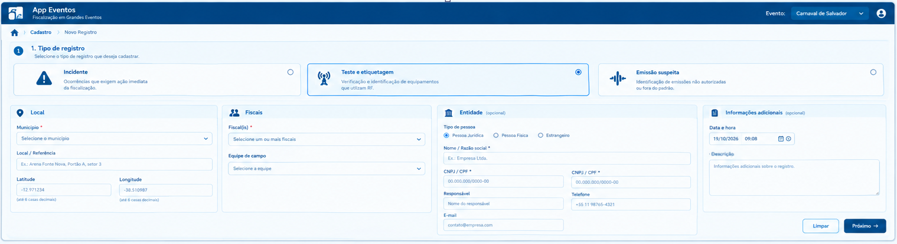
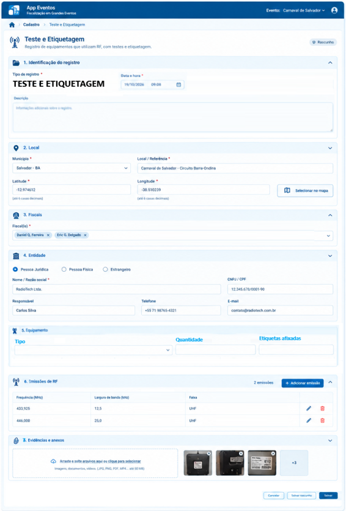
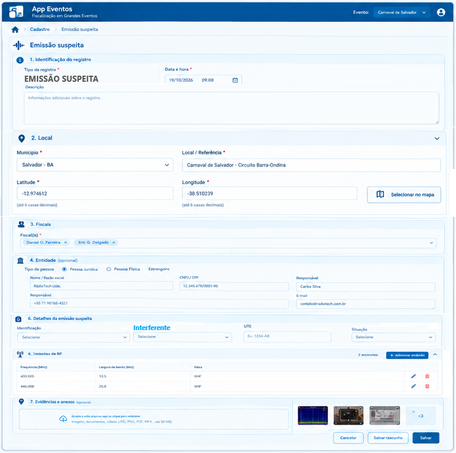
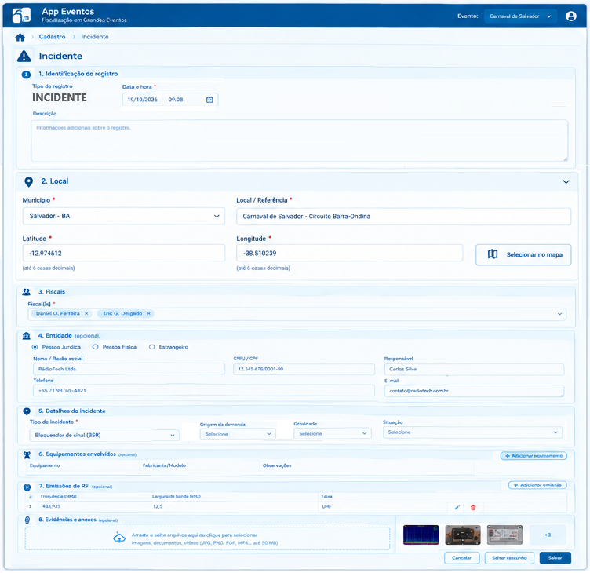
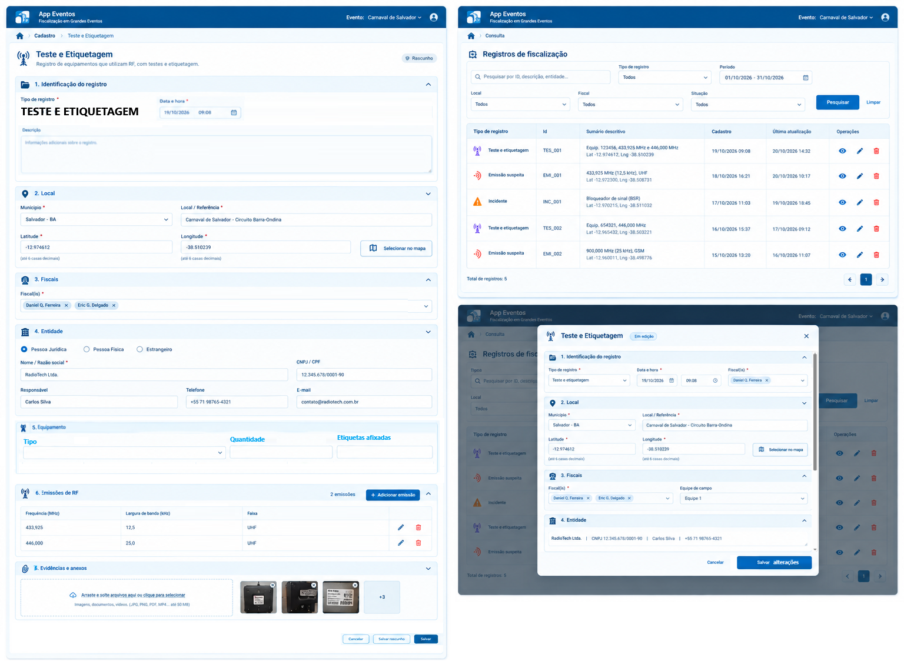
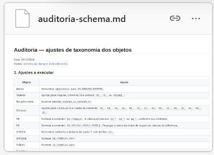

**Eric Magalhaes Delgado**

**Andre Vinicius Pereira de Rezende** e colegas.

A análise apresentada a seguir é restrita à interface gráfica. Imagino que demandará ajuste no banco de dados.

Em relação ao módulo de CADASTRO, sugiro o seguinte:

* Uma tela inicial em que se escolhe o tipo de registro a cadastrar ("Teste e etiquetagem" | "Emissão suspeita" | "Incidente") e são inseridas informações comuns aos registros, como "Data", "Descrição", "Entidade", "Fiscais" e "Local".
* Ao clicar no botão "Próximo", abre-se o formulário específico do tipo de registro em que já estão preenchidas as informações comuns (importada da tela inicial de cadastro).
  * No de "Teste e etiquetagem" consta os painéis de "Equipamentos" e "Emissões de RF").
  * No de "Emissão suspeita" consta os painéis "Detalhes da emissão suspeita" e "Emissões de RF".
  * No de "Incidentes" consta os painéis "Detalhes do incidente", "Equipamentos" e "Emissões de RF".

As validações p/ que um formulário seja aceito depende do seu tipo. Por exemplo, no "Teste e Etiquetagem" é obrigatório inserir ao menos uma emissão; no "Incidentes", não. No "Teste e etiquetagem", exceto CNPJ, todas as outras informações sobre a entidade são obrigatórias; no de "Emissões suspeitas", não.

 Tive que editar no Paint3D as imagens... então tem coisas esquisitas aí, mas o objetivo é só apresentar a ideia da simplificação da atual GUI.

Em relação ao módulo de CONSULTA, sugiro algo bem simples que apresenta, num só local, tudo. Vide abaixo a tela de cadastro do "Teste e Etiquetagem", a tela de consulta e a edição de registro de "Teste e etiquetagem".

Perceba que o formulário de edição do registro, apresentado em popup no módulo de CONSULTA, é idêntico ao renderizado no CADASTRO.

Só o container muda... e as permissões de editar ou não os campos. Porque aí, na CONSULTA, é possível também apenas visualizar os detalhes do registro.

Importante destacar que a tabela que retorna da CONSULTA precisa ser resumida.

Outro ponto importante que precisa ser evoluído é a consistência estética em relação à renderização de uma tabela, dos botões, em que local aparecem etc. Nesse aspecto, importante implantar um approach de reaproveitamento de componentes. Precisa ter uma única função, num .JS do projeto, que é importado por todos os .HTML, que renderiza a tabela.

Considerando a similaridade dessas telas de cadastro, eu iria um pouco além... eu deixaria um único HTML p/ consulta e um único p/ cadastro. E as peculiaridades do tipo de cadastro eu geraria programaticamente via .JS.

Então você teria um esquelo quase pronto... mas injetaria algumas coisas ali...

O mesmo p/ progressdialog modal que bloqueia interação com a tela... talvez enquanto salva-se o registro em banco. Ou um popup de confirmação de operação. A geração desses componentes precisa ser centralizada.

Sei que essas coisas são básicas... mas acho que o Copilot não entendeu o qual grande ficou o projeto, aí precisa alinhar com ele p/ garantir essas coisas.

Andre Vinicius Pereira de Rezende, **Fabio Santos Lobao** e **Augusto César Federici Peterle**

Analisem essas sugestões acima p/ definirmos os próximos passos, incluindo aí a revisão das tabelas do banco.

Caso tenham dúvidas sobre como está hoje o app, acessam o link que André compartilhou:

[https://font-calorie-fragile.ngrok-free.dev/](https://font-calorie-fragile.ngrok-free.dev/ "https://font-calorie-fragile.ngrok-free.dev/")

Ainda pendente, de minha parte, uma análise de outros telas:

* Cadastro de eventos
* Tela do coordenador
* Tela do ticket

---

Feedbacks sobre testes na atual GUI:

**Criação de evento:**

(a) Campos precisam ser obrigatórios. Criei evento sem lat, lng etc.

(b) Alguns campos não podem ser editados posteriormente. Se há indicação de teste de etiquetagem, por exemplo, com seleção de etiquetas e tal, no futuro não podemos desmarcar isso.

**Teste e etiquetagem:**

(a) Campo de inclusão de frequência precisa ter limite superior. Sugeriria 60GHz (ou algo menor)

(b) No campo de inclusão de emisão, se clicar fora do popup, o popup fecha. Melhor voltar ao tradicional X no topo direito do popup.

(c) Como editar registro do teste?! O "+" na primeira coluna. Diferente das outras tabelas, em que se tem botão de edição na última. Independente disso, se ocorre um warning, como selo não validado, a edição do formulário é fechada.

(d) Tela de consulta com todas as colunas do formulário.

**Incidentes:**

(a) Aceita cadastro com muitos campos vazios.

---

**Eric Magalhaes Delgado**

Vamos conversar amanhã. Ouvir opinião de Lobão e Augusto também. Ao final do dia, perceba que as telas acima apresentadas são funcionalmente espelhos do que consta hoje, com inclusão de alguns poucos campos. Então a coisa não deve ser tão dramática.

Mas importante... por exemplo: numa fiscalização, se identifico um equipamento que gera *n *emissões, não faz sentido eu inserir *n* registros de emissões. É um registro apenas com* n* emissões.

Mas sim. Vamos conversar internamente. E depois trocar ideia com Léo.

**Augusto César Federici Peterle**

To terminando a revisão aqui, basicamente ajustar as taxonomias ao padrão da GIIB

[TIC-Dados-Padroes-de-Modelagem-de-Bancos-de-Dados.aspx](https://anatel365.sharepoint.com/sites/WikiAnatel/SitePages/TIC-Dados-Padroes-de-Modelagem-de-Bancos-de-Dados.aspx?web=1 "https://anatel365.sharepoint.com/sites/wikianatel/sitepages/tic-dados-padroes-de-modelagem-de-bancos-de-dados.aspx?web=1")

[Auditoria Schema](D:\NetbeansProjects\appgrandeseventos\requisitos\auditoria-schema.md)

Coloquei como sugestão de nomes, baseado nas regras da GIIB. Muita coisa lá não se aplicará: por exemplo utilização do SAP Power Designer, Microsoft SQL Server 2014. Foco foi em padronizar taxonomia de banco, tabelas, bridges, PKs, FKs, índices, checks, funções e sequências.
